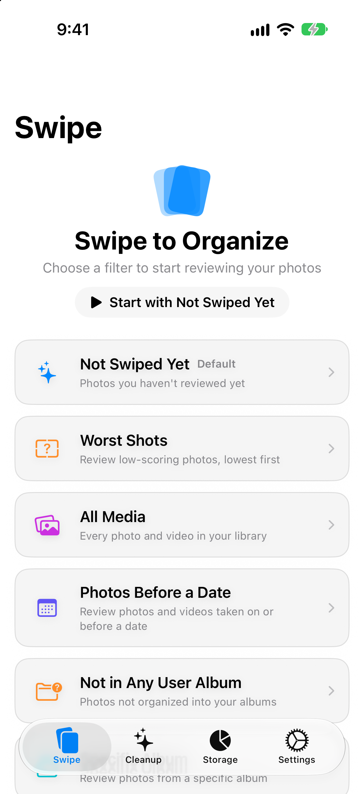
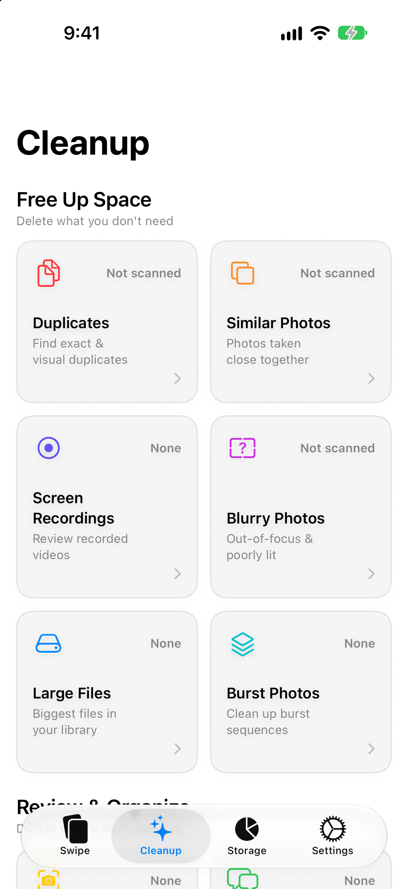
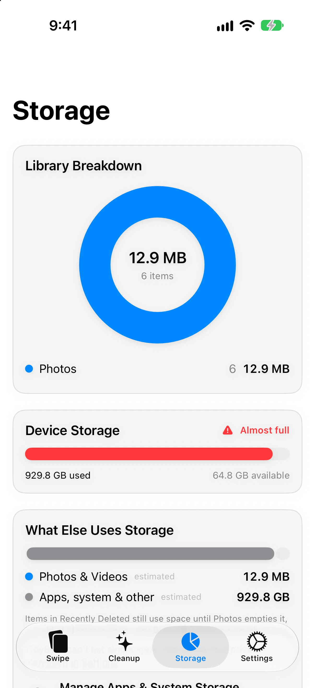
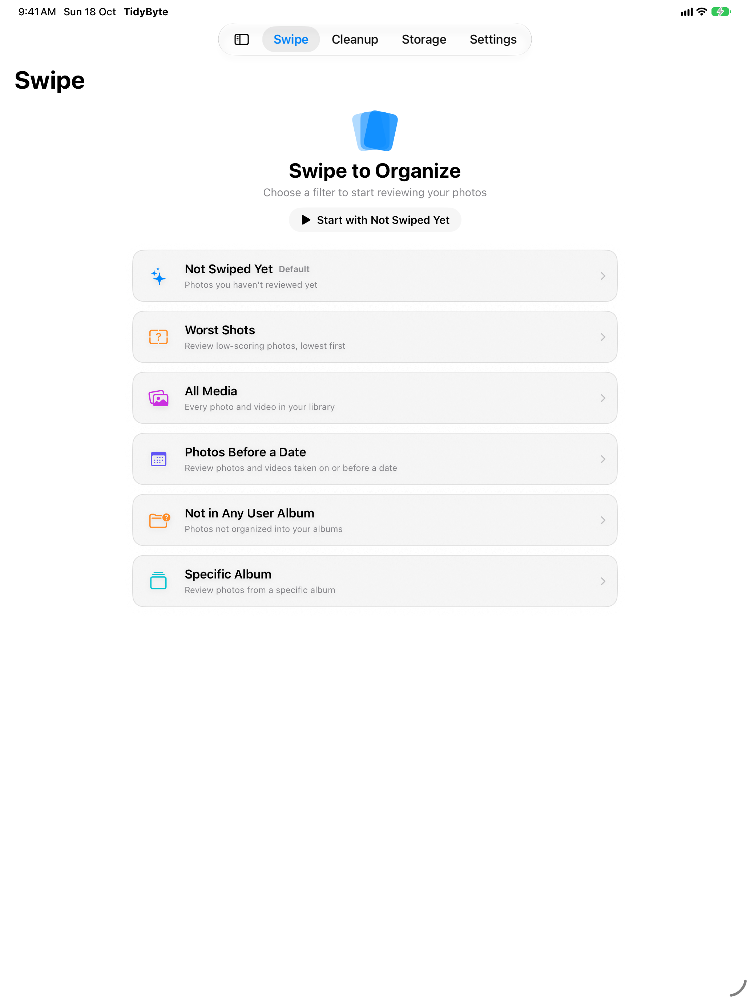
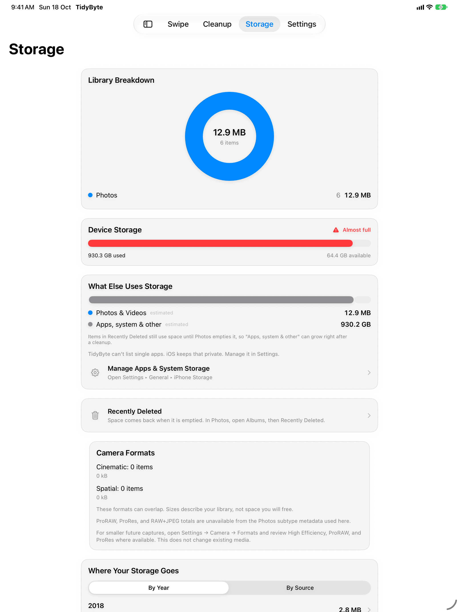

# TidyByte

[](https://github.com/360ghar/tidybyte/actions/workflows/ci.yml)
[](LICENSE)
[](https://apps.apple.com/in/app/tidybyte/id6775769763)

A native iOS app that helps users clean up their photo library. Core UX is a Tinder-style swipe interface for reviewing media.

- **Swift/SwiftUI**, iOS 17+, iPhone (portrait) + iPad + iPhone Duo
- **No backend** — all processing on-device
- **No third-party dependencies** — Apple frameworks only
- MVVM + Actors + SwiftData architecture
- **21 languages** (including RTL) across the app, the App Store listing, the
  site, and the Siri phrases

## Screenshots

Captured by `npm run screenshots`, which drives the simulator and writes both
required App Store device classes with alpha stripped.

<p align="center">
  
  
  
  
  
</p>

The flat `docs/screenshots/*.png` files are legacy, carry an alpha channel that
App Store Connect rejects, and must not be uploaded.

## Features

- Swipe-based photo review (keep/delete)
- Duplicate & similar photo detection (SHA-256 + Vision feature prints)
- Blurry photo detection
- Screenshot, burst, and Live Photo cleanup
- Large file finder
- Video compression
- Storage dashboard
- Activity & savings history (lifetime space freed, 30-day chart, per-tool breakdown)
- Home Screen widget with interactive Swipe / Screenshots buttons, plus Siri and Shortcuts intents

## Requirements

- Xcode 26+ (required for App Store builds; runtime supports iOS 17+)
- iOS 17+ device (photo library operations require a physical device)
- [XcodeGen](https://github.com/yonaskolb/XcodeGen)

## Build & Run

```bash
# Generate Xcode project from project.yml
xcodegen generate

# Build and test on any installed iPhone simulator
# (list them with: xcrun simctl list devices available)
xcodebuild build -project Tidybyte.xcodeproj -scheme Tidybyte \
  -destination 'platform=iOS Simulator,name=iPhone 17 Pro' CODE_SIGNING_ALLOWED=NO
xcodebuild test -project Tidybyte.xcodeproj -scheme Tidybyte \
  -destination 'platform=iOS Simulator,name=iPhone 17 Pro' CODE_SIGNING_ALLOWED=NO
```

To run on your own iPhone, see
[Run on your own iPhone](CONTRIBUTING.md#run-on-your-own-iphone).

## Project Structure

```
Tidybyte/
├── App/           # @main entry + RootView (TabView)
├── Models/        # SwiftData models + DTOs
├── Services/      # Actor-based services
├── Features/      # Feature modules (Swipe, Cleanup, Storage, Settings)
└── Shared/        # Reusable components, extensions, utilities
```

Configuration lives in `project.yml` (XcodeGen). The `.xcodeproj` is generated and not checked into version control.

## Localization

The app, the App Store listing, the marketing site, and the Siri phrases are all
translated into 21 languages. Two String Catalogs, and they are not
interchangeable:

| Catalog | Serves |
|---|---|
| `Tidybyte/Resources/Localizable.xcstrings` | everything the app draws |
| `Tidybyte/Resources/AppShortcuts.xcstrings` | the Siri phrases, which App Intents looks up in a table named `AppShortcuts` |

A Siri phrase put in the app catalog instead is never read, and the app catalog
still reports 100% coverage. That mistake shipped once.

```bash
./scripts/localization/refresh.sh        # rebuild both catalogs from source
node scripts/localization/extract.mjs --check   # find text that never reaches a catalog
node scripts/localization/check.mjs --strict    # coverage, placeholders, plural categories
```

`refresh.sh` is deterministic — running it twice produces byte-identical files,
which is what makes the CI gate a `git diff --exit-code`. See
[`scripts/localization/README.md`](scripts/localization/README.md) for the
pipeline and the bug classes each scan exists to catch.

## Growth & marketing assets

App Store creatives for In-App Events, Custom Product Pages, the Asset Library,
Product Page Optimization, and the header/search surfaces — 357 images across 21
languages.

```bash
npm run growth          # render every asset for every language
npm run check:growth    # validate sizes, alpha, coverage, blank renders
npm run screenshots     # capture iPhone + iPad screenshots
```

Background art is generated with AI and is deliberately text-free; the text layer
is rendered by Chromium from the app's own translated strings, because Apple
requires asset text localized for every supported language and a diffusion model
cannot render 20 scripts reliably. See
[`docs/growth/README.md`](docs/growth/README.md).

## Contributing

Contributions are welcome. Read [CONTRIBUTING.md](CONTRIBUTING.md) for setup, the
CI checks, and how to send a pull request.

- New here? Start with a
  [`good first issue`](https://github.com/360ghar/tidybyte/labels/good%20first%20issue).
- Questions and ideas go to
  [Discussions](https://github.com/360ghar/tidybyte/discussions).
- Found a bug? Use the
  [bug report form](https://github.com/360ghar/tidybyte/issues/new/choose).
- Security problems: follow [SECURITY.md](SECURITY.md).

This project follows a [Code of Conduct](CODE_OF_CONDUCT.md).

## Support the project

TidyByte is free, with no ads, accounts, or subscriptions. If it saves you
space, you can support its development:

- [Sponsor on GitHub](https://github.com/sponsors/saksham1991999)
- Star the repository
- Rate the app on the [App Store](https://apps.apple.com/in/app/tidybyte/id6775769763)

## License

This project is licensed under the MIT License — see the [LICENSE](LICENSE) file for details.
